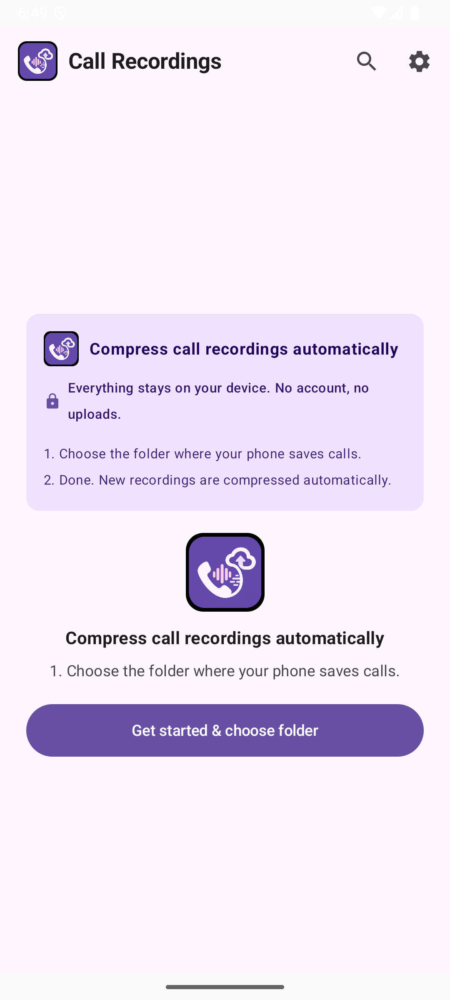
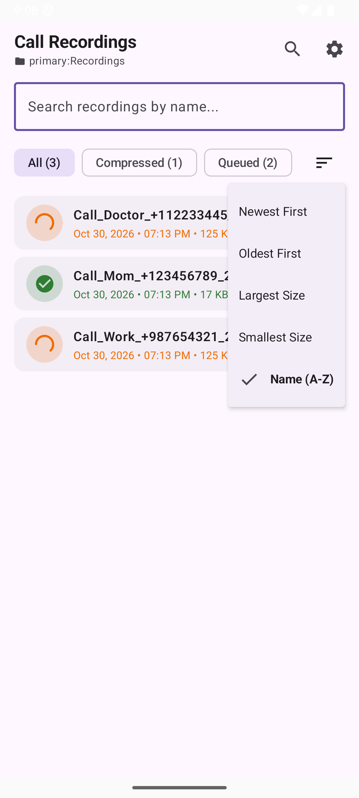
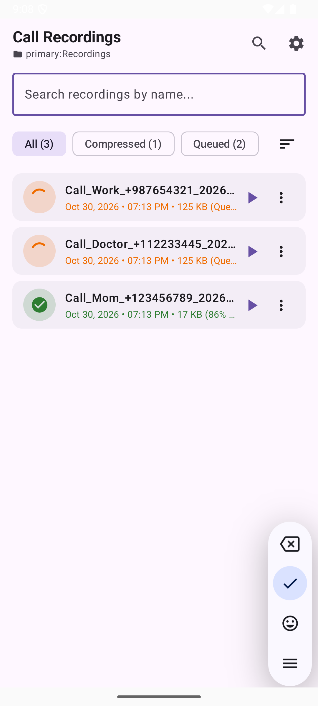
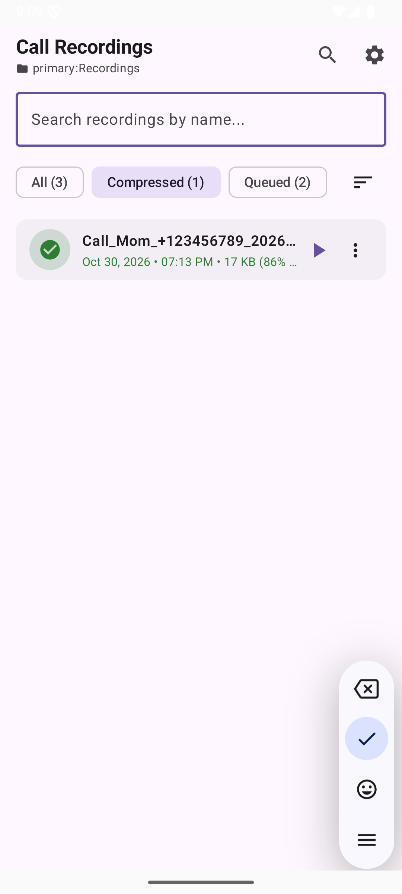
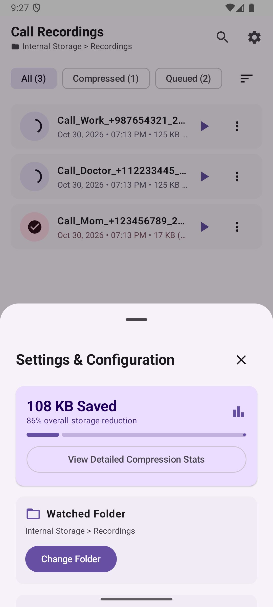
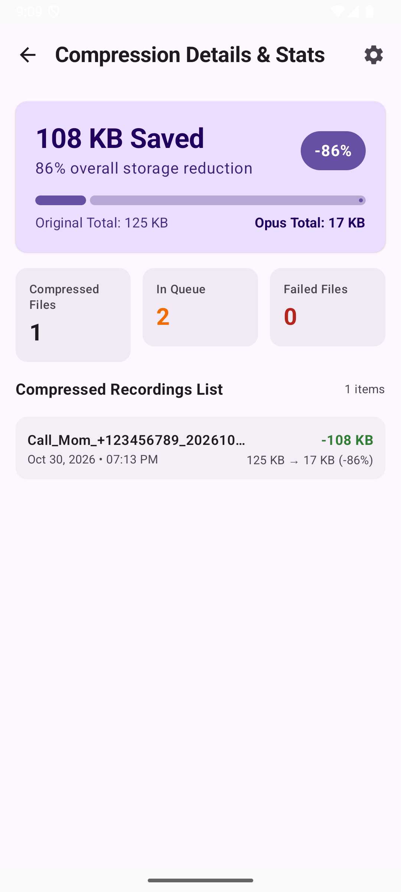
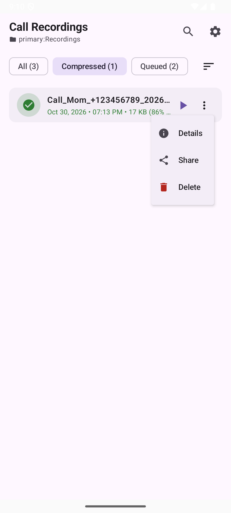
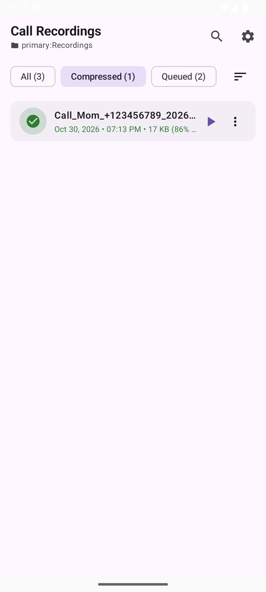

# CallCompressor App Screenshots & UI Audit Gallery

All screenshots are stored in the project root directory and rendered below:

---

## 1. Home Screen

---

## 2. Three-Dot Overflow Context Menu

---

## 3. Recording Details Bottom Sheet

---

## 4. Active Mini Audio Player Bar

---

## 5. Settings & Configuration Sheet

---

## 6. Compression Details & Stats Screen

---

## 7. Active Search Bar

---

## 8. Sort Menu Dropdown

---

## 9. Delete Confirmation Dialog

